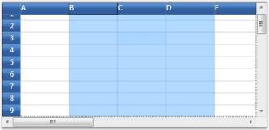
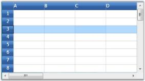
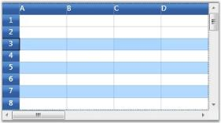
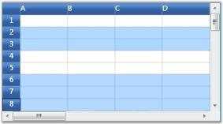

# WPF GridControl Selection

This repository contains the samples which shows the different selection of [WPF GridControl](https://www.syncfusion.com/wpf-controls/excel-like-grid).

## Selection modes
There are two modes of selection available in the GridControl. They are,

* Range selection
* Record selection

### Range selection
1. In Range selection, you will be able to select cell ranges; but the selections will have no knowledge of nested tables, grouping or sorting and hence the functionality is limited like a data bound grid (GridData control).
2. To use the model selection capability, set AllowSelections to any flag except none.
3. Selection can be made through keyboard and mouse.

### Record selection
1. It is designed specifically for the data bound grids.
2. In Record selection, the complete grid records (rows) will be selected and these selections function properly with nested tables, sorting, and so on.
3. To use the record selections, you must set AllowSelections to none and then set ListBoxSelectionMode to any flag except none.
4. Selection can be made through keyboard and mouse with some restriction. For more details, see Record-based Selection in this topic.

## Range selection
Range selection is a cell-based selection mode that allows you to do a selection across the cell by using the [AllowSelection](https://help.syncfusion.com/cr/wpf/Syncfusion.Windows.Controls.Grid.GridModelOptions.html#Syncfusion_Windows_Controls_Grid_GridModelOptions_AllowSelection) property. It accepts value from [GridSelectionFlags](https://help.syncfusion.com/cr/wpf/Syncfusion.Windows.Controls.Grid.GridSelectionFlags.html) enumeration. Default value for `AllowSelection` is `Any` and the specified range of Cell/Row/Column or Table can be highlighted using the range section.

The possible values for this type of selection are defined by the enum `GridSelectionFlags`. To control the selection behavior of the grid, set any of the following flags to the AllowSelection property.

### Selection flags

<table>
<tr>
<th>
Flag</th><th>
Description</th></tr>
<tr>
<td>
None</td><td>
Disables selecting of cells.</td></tr>
<tr>
<td>
Row</td><td>
Allows selection of rows.</td></tr>
<tr>
<td>
Column</td><td>
Allows selection of columns.</td></tr>
<tr>
<td>
Table</td><td>
Allows selection of the whole table.</td></tr>
<tr>
<td>
Cell</td><td>
Allows selection of an individual cell.</td></tr>
<tr>
<td>
Multiple</td><td>
Allows selection of multiple ranges of cells. The user has to press CTRL Key to select multiple ranges.</td></tr>
<tr>
<td>
Shift</td><td>
Allows extending existing selection when user holds SHIFT Key and clicks on a cell.</td></tr>
<tr>
<td>
Keyboard</td><td>
Allows extending existing selection when user holds SHIFT Key and presses arrow keys.</td></tr>
<tr>
<td>
MixRangeType</td><td>
Allows both rows and columns to be selected at the same time when Multiple is specified. By default, the grid does not allow row and column ranges to be selected at the same time.</td></tr>
<tr>
<td>
Any</td><td>
Allows selection of rows, columns, table, cell and multiple ranges of cells; also extends SHIFT Key support and alpha blending.</td></tr>
</table>

**Note:** You can combine more than one flag to customize the current selection behavior.

``` csharp
grid.Model.Options.AllowSelection = GridSelectionFlags.Multiple | GridSelectionFlags.Column;
```



## Record selection
This type of selection mechanism allows selection in terms of record (entire row). It is not cell-based. This selection mode is specifically designed for a data-bound grid, in which the grid data can be organized as a collection of record rows.

Grid offers the following three types of record selections which are together called as [ListBoxSelectionMode](https://help.syncfusion.com/cr/wpf/Syncfusion.Windows.Controls.Grid.GridModelOptions.html#Syncfusion_Windows_Controls_Grid_GridModelOptions_ListBoxSelectionMode).

* SelectionMode - One
* SelectionMode - MultiSimple
* SelectionMode - MultiExtended

To enable record selection, set the `ListBoxSelectionMode` property to any of the above specified List Box Selection Mode values. To enable list box selection, turn off the range selection by setting the `AllowSelection` property to `Row`. Below is a detailed description of list box selection modes.

### SelectionMode-One
It allows you to select only one item (record). For example, you have selected a record. Now if you select some other record, the previous record selection will be cleared. Hence it is a One record selection mode.

``` csharp
grid.AllowSelection = GridSelectionFlags.Row;
grid.Model.Options.ListBoxSelectionMode = GridSelectionMode.One;
```



**Note:** Record can be selected using a single mouse click or using UP or DOWN Arrow Keys

### SelectionMode - MultiSimple
In this selection mode, you will be able to select multiple items individually. For instance, you have selected a record using mouse and you want to select one more record. Click another record and you will notice that the previous selection is not cleared. Hence You can select multiple records without the need of SHIFT or CTRL keys.

``` csharp
grid.AllowSelection = GridSelectionFlags.Row;
grid.Model.Options.ListBoxSelectionMode = GridSelectionMode.MultiSimple;
```



**Note:** It does not support the use of SHIFT, CTRL and arrow keys to extend the selection.

### SelectionMode - MultiExtended
This selection type allows multiple items selection through SHIFT, CTRL and arrow keys.

You can do any of the following when this selection mode is enabled:

* Select a record, hold down the SHIFT key and select fourth record, for example. You will notice all the records in between 1st and the 4th records are also selected.
* You can make random selection by holding down the CTRL key.
* Hold down the Shift key and select the records using the UP or DOWN ARROW keys.

``` csharp
grid.AllowSelection = GridSelectionFlags.Row;
grid.Model.Options.ListBoxSelectionMode = GridSelectionMode.MultiExtended;
```

